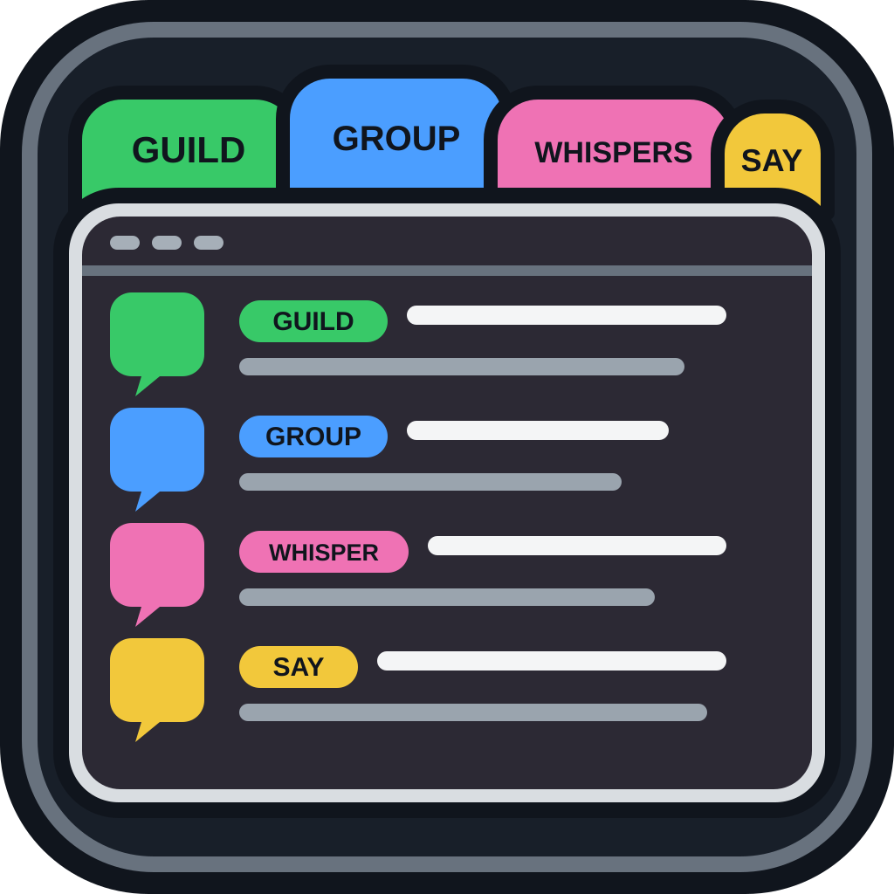

# Chat Tabs Organizer

<p align="center">
  
</p>

Chat Tabs Organizer is a World of Warcraft addon for Retail and WoW Forever that helps keep chat windows separated by purpose: guild, party/raid, communities, trade/services, whispers, local channels, and any custom tabs you define.

## How It Works

Open the settings from **Options > AddOns > Chat Tabs Organizer** or with:

```text
/ctabs options
```

By default the addon updates your managed tabs a couple of seconds after you log in or reload. Turn off **Apply automatically at login** if you prefer to update only when you click **Apply now** or type `/ctabs apply`.

When applied, the addon:

- creates enabled tabs that are missing, and reuses existing ones instead of making duplicates
- closes the windows of tabs you turned off (only windows it created or took over; your own windows, the main chat window and the Combat Log are never closed)
- routes guild, party/raid/instance, community, trade/services, whisper and local channel messages into their tabs
- keeps managed tabs docked in the order you set, after your own tabs
- optionally removes routed messages from your main chat tab, so they don't show up twice
- optionally joins the named channels used by enabled tabs

### Tab editor

The **Tabs** page under the addon's settings lets you:

- turn tabs on and off and change their order
- rename any tab
- choose which message types each tab shows (say, guild, officer, party, raid, instance, whispers, Battle.net whispers, communities, loot, achievements and more)
- list named channels by name, for example `Trade, Services` (use the names your game client shows; `Trade` also matches `Trade - City`)
- add up to 10 tabs in total, including your own custom tabs

### Appearance

Visual settings apply live to every chat tab, including tabs the addon didn't create and whisper windows:

- background color and opacity
- font face
- font size

WoW doesn't save the chat font face, so the addon re-applies it at every login.

## Install

1. Put the `ChatTabsOrganizer` folder in your game's `Interface/AddOns` folder: `_retail_/Interface/AddOns` for Retail, `_forever_/Interface/AddOns` for WoW Forever.
2. Restart the game or run `/reload`.
3. Open the addon settings, then the **Tabs** page, and choose the tabs you want.

## Commands

```text
/ctabs options        open settings
/ctabs tabs           open the tab editor
/ctabs apply          update chat tabs now
/ctabs list           list managed tabs
/ctabs tab trade off  turn a tab on or off by name
/ctabs join           join named channels used by enabled tabs
/ctabs enable         turn the addon on
/ctabs disable        turn the addon off and leave chat windows alone
/ctabs reset          restore default settings
```

## Uninstalling

If you turned on **Remove routed messages from the main chat tab**, turn it off (or type `/ctabs disable`) before removing the addon, so those messages return to your main chat tab.

## License

All rights reserved unless a different license is added.
